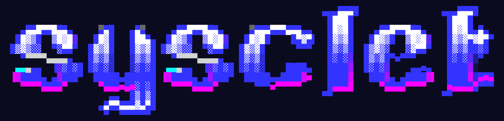
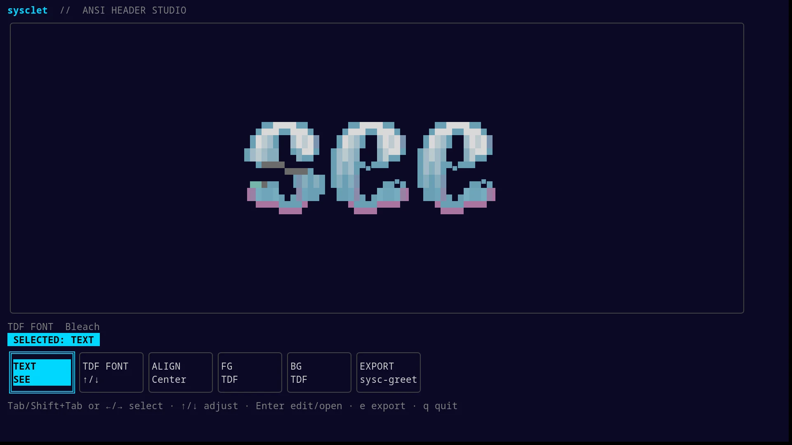

<div align="center">



### sysclet · ANSI Header Studio and TheDraw Font Catalog

[](LICENSE)

[](https://go.dev/)

[Features](#features) · [Quick Start](#quick-start) · [TUI](#tui) · [CLI](#cli) · [Font Catalog](#font-catalog) · [sysc-greet Export](#sysc-greet-export) · [Development](#development) · [License](#license)



</div>

---

## Features

| Feature | What it does |
| --- | --- |
| **ANSI header editor** | Edit text in a full-screen terminal UI and see the TheDraw output update as you type. |
| **4,359 bundled font records** | Search and preview the bundled catalog without a network connection. Load other `.tdf` files from disk. |
| **Authored color and alignment** | Keep each TDF cell's foreground and background by default. Choose left, center, or right alignment, or override either ANSI color. |
| **sysc-greet export** | Preview a profile slot, create a new profile, or update an existing one with a backup. |
| **ANSI export** | Save the colored terminal output as `.ans` and keep its escape sequences intact. |
| **sysc-walls and sysc-terminal export** | Save the header as plain-text artwork for their text effects. The sysc-walls target also points its config at the file. |
| **Command line** | Render a header or print an escaped sysc-greet profile snippet without opening the TUI. |

The program embeds its font data. Clipboard copying uses the system clipboard utility when available; other features work without one.

## Quick Start

Install for your user on Linux distributions with Go and POSIX `sh`:

```sh
curl -fsSL https://raw.githubusercontent.com/Nomadcxx/sysclet/main/install.sh | sh
```

Run the installer from an interactive terminal as your user, without `sudo`. It needs Go 1.21 or newer and network access (Go fetches the 1.26.10 toolchain the module declares), and installs sysclet to `~/.local/bin/sysclet` without using a distro package manager. The TDF fonts are bundled in the binary. If `~/.local/bin` is not on your `PATH`, run `~/.local/bin/sysclet`.

You can install directly with Go instead:

```sh
mkdir -p "$HOME/.local/bin"
GOBIN="$HOME/.local/bin" go install github.com/Nomadcxx/sysclet@latest
```

Or install from the AUR:

```sh
yay -S sysclet-git
```

Run `sysclet` to open the editor.

## TUI

The screen has a large ANSI preview, a control strip, and keyboard hints. The active control is named above the strip and highlighted. The initial font is **Bleach**. The full font name appears above the controls; select **TDF FONT** and use `↑` / `↓` to cycle fonts. Press `Enter` on **TDF FONT** to search the bundled catalog or browse a local `.tdf` file.

| Key | Action |
| --- | --- |
| `Tab` / `Shift+Tab` | Move through controls; in export, cycle formats while the format row is focused |
| `←` / `→` | Move between text, font, alignment, colors, and export controls |
| `↑` / `↓` | Change the selected setting; cycle fonts at **TDF FONT** or formats on the export format row |
| `Enter` | Edit text or open the selected control |
| `Ctrl+O` in the font list | Browse for a local `.tdf` file |
| `e` | Open export options, starting with sysc-greet |
| `Ctrl+O` / `Ctrl+B` in export | Browse for a file matching the selected export format |
| `Ctrl+S` in export | Save the selected format; existing files get a backup |
| `Esc` | Close the active editor or picker |
| `q` | Quit |

The `FG` and `BG` controls cycle through the 16-color ANSI palette and **TDF**, which restores the font's stored color for each cell. Alignment changes only the position of the rendered header.

In sysc-greet export, `F5` copies the plain profile snippet without the surrounding TUI. On Linux, install `wl-clipboard` for Wayland or `xclip` or `xsel` for X11. These are optional dependencies for `sysclet-git`.

To load local fonts, place them in `~/.local/share/sysclet/fonts` (or `$XDG_DATA_HOME/sysclet/fonts`) and choose **TDF FONT → Ctrl+O**. A file with multiple records opens a searchable font-name list.

## CLI

Render with a bundled font:

```sh
sysclet render --font-name Bleach SYSC
```

Render from a local file, including a named record in a multi-font file:

```sh
sysclet render --font ./fonts/my-fonts.tdf --font-name "Font Name" "SEE YOU"
```

Print a sysc-greet snippet for review:

```sh
sysclet export --font-name Bleach --slot ascii_1 COWBOY
```

Choose another export target with `--format` (`sysc-greet`, `ansi`, `txt`, `go`, `js`, `py`, `rs`, `sh`, `sysc-walls` or `sysc-terminal`). ANSI, TXT and source formats print to stdout unless you pass `--output`; the sysc-walls and sysc-terminal targets need `--output`, a bare name or a path, and follow the rules in [sysc-greet Export](#sysc-greet-export):

```sh
sysclet export --font-name Bleach --format txt SYSC > header.txt
sysclet export --font-name Bleach --format sysc-walls --output header SYSC
```

List bundled fonts, optionally filtered, or the records in a local file:

```sh
sysclet fonts rivendell
sysclet fonts --font ./fonts/my-fonts.tdf
```

Text accepts printable ASCII (`!` through `~`) and spaces. Include at least one non-space character, and use a font with a glyph for every non-space character.

Run `sysclet --help`, `sysclet render --help`, or `sysclet export --help` for options, and `sysclet --version` for the installed version.

## sysc-greet Export

The TUI starts with sysc-greet and detects a matching profile from the active compositor or desktop session when possible. It selects the next `ascii_N` slot by default. Edit the slot field to replace a specific entry. The snippet preview shows the selected slot with ANSI colors. `Ctrl+S` updates an existing profile with a timestamped backup or creates a profile with `ansi_style=true` and the selected slot. `Ctrl+O` and `Ctrl+B` open the file picker from any export field; type a path directly when the file does not exist yet.

Press `Tab` or `Shift+Tab` on the format row to cycle formats. Press `Enter` to move to the destination, then use `Tab` to reach the optional sysc-greet slot. **ANSI** saves colored output as `.ans`; display it in a terminal with `cat header.ans` or `less -R header.ans`. **TXT** removes ANSI colors. **GO**, **JS**, **PY**, **RS**, and **SH** export runnable source and show a run command in the TUI. sysclet adds the format extension when needed and backs up an existing file before replacing it.

**sysc-walls** and **sysc-terminal** save plain text, because both apps draw the art in their own theme colors. A bare name such as `header` saves to `~/.local/share/syscgo/walls/header.txt`; other paths must be under `~/.local/share` or `~/.config`, the only places these apps read artwork from. The sysc-walls target also sets `effect = beam-text`, `theme = dracula`, `file` and `cycle = false` in the `[animation]` section of `~/.config/sysc-walls/daemon.conf`, the same values sysc-Go's export uses. It keeps the file's other lines and comments and saves a backup first. Restart the daemon with `systemctl --user restart sysc-walls.service`. For sysc-terminal, the TUI shows the `sysc-terminal --effect beam-text --file …` command to run.

sysclet does not request elevated privileges. User-owned profile paths can be saved normally; root-owned system paths require running sysclet with `sudo`. Existing permission bits are preserved when updated, and a new file belongs to the user running sysclet with mode `0644` limited by the system umask. Run the TUI as root only when editing a system-owned profile:

```sh
sudo "$HOME/.local/bin/sysclet"
```

If you installed sysclet elsewhere, replace this path with the installed binary path.

Run this command to update a system profile as root:

```sh
sudo "$HOME/.local/bin/sysclet" export --font-name Bleach --slot ascii_1 \
  --config /usr/share/sysc-greet/ascii_configs/sysc-compositor.conf COWBOY
```

sysc-greet maps the ANSI colors through the selected theme. The profile stores the art and colors. Select the **Beams** display effect in sysc-greet to animate it.

## Font Catalog

sysclet bundles 4,359 named TDF records from 47 font packs: 3,481 distributed through TAAG's [TheDraw font sets](https://patorjk.com/software/taag/tdf-font-sets/), 723 more from [Phosphor](https://github.com/0xc1c4da/phosphor)'s TheDraw collection, and 155 converted from [sysc-Go](https://github.com/Nomadcxx/sysc-Go)'s BIT fonts. `scripts/import_fonts.py` rebuilds the Phosphor and BIT packs from their sources. The TUI and CLI work offline. Individual records can have different authors and terms; see [THIRD-PARTY-NOTICES.md](THIRD-PARTY-NOTICES.md) for source and license details. The GPL license for sysclet's code does not apply to those font files.

## Development

To build and install from a source checkout, use Go 1.21 or newer; Go fetches the 1.26.10 toolchain the module declares:

```sh
git clone https://github.com/Nomadcxx/sysclet.git
cd sysclet
mkdir -p "$HOME/.local/bin"
go build -o "$HOME/.local/bin/sysclet" .
```

The first build downloads Go modules. The font catalog is embedded in the binary, so running sysclet does not require Go or network access.

Run the tests and vet before submitting changes:

```sh
go test ./...
go vet ./...
```

GitHub Actions runs gofmt, vet, race tests and a build on the Go version in `go.mod` for pull requests and pushes to `main`.

See [docs/design.md](docs/design.md) for package responsibilities, data flow, and file-update guarantees.

## License

sysclet's code is licensed under [GPL-3.0-only](LICENSE). Bundled font files are third-party assets with separate terms, documented in [THIRD-PARTY-NOTICES.md](THIRD-PARTY-NOTICES.md).
